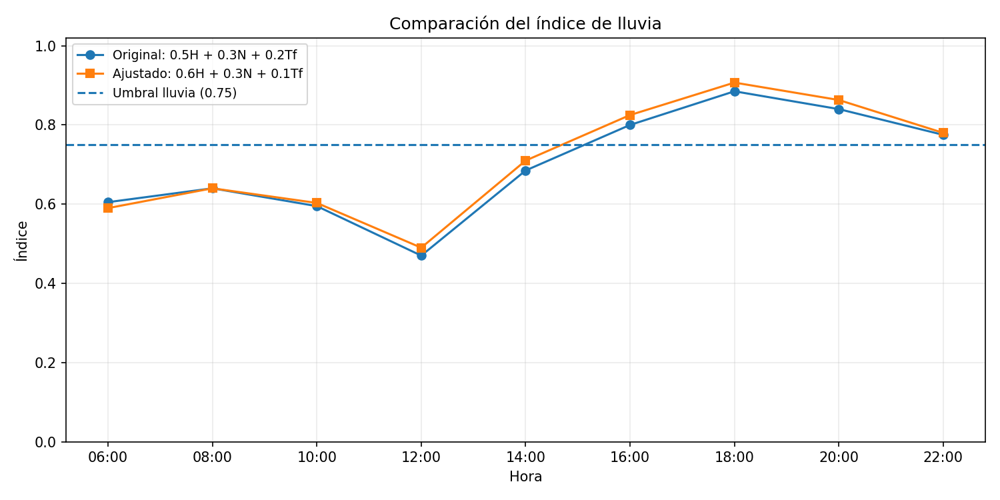

# APE 1: construcción y simulación computacional de un modelo matemático

Esta práctica de **Simulación (Unidad 1, Semana 1)** implementa el índice de lluvia que describe la guía APE 001 de la Universidad Nacional de Loja. Se estudian los registros meteorológicos de nueve horas del día, se completan las columnas `H`, `N`, `Tf` e `Índice`, se interpreta el estado asociado y se propone un **ajuste del modelo** para comparar los resultados.

Se mantiene la fórmula original de la guía:

`I = 0.5 × H + 0.3 × N + 0.2 × Tf`

con `H = humedad/100`, `N = nubosidad/100` y `Tf` según la tabla de temperaturas. Se incluye también una versión ajustada, propuesta para el ejercicio: `I = 0.6 × H + 0.3 × N + 0.1 × Tf`. Los pesos siempre suman 1.

## Tecnologías

- **Python 3.10+**: programación principal.
- **NumPy**: entorno de cálculos numéricos (dependencia disponible para ampliaciones).
- **Matplotlib**: gráficas de la evolución del índice de lluvia.
- **pytest**: pruebas automatizadas.

## Instalación y ejecución

Desde `Unidad 1/Semana 1`, crear un entorno virtual:

```powershell
python -m venv .venv
```

Activar el entorno en **Windows PowerShell**:

```powershell
.\.venv\Scripts\Activate.ps1
```

En **Linux o macOS**:

```bash
source .venv/bin/activate
```

Instalar y ejecutar:

```bash
python -m pip install -r requirements.txt
python main.py
```

El programa imprime dos tablas (original y ajustada), y genera tablas CSV y gráficas en `resultados/` sin solicitar valores manuales. Para guardar en otra carpeta se puede usar `python main.py --salida mis_resultados`.

## Resultados

- `resultados/tabla_original.csv`: tabla completada con los datos y las reglas de la guía.
- `resultados/tabla_ajustado.csv`: la misma tabla con pesos ajustados.
- `resultados/lluvia_original.png`: evolución del índice original y sus umbrales.
- `resultados/lluvia_ajustado.png`: evolución del índice ajustado.
- `resultados/comparacion_modelos.png`: comparación de ambas simulaciones.



La evolución permite distinguir intervalos de crecimiento y descenso del índice; por ejemplo, el índice disminuye hacia las 12:00 y posteriormente aumenta hacia las 18:00. Este índice no constituye un pronóstico meteorológico real, sino el resultado del modelo matemático educativo.

## Estructura

```text
Semana 1/
├── main.py                 # Punto de entrada y controlador de ejecución
├── README.md               # Explicación, resultados y preguntas de control
├── requirements.txt        # Dependencias
├── src/
│   ├── __init__.py
│   ├── datos.py             # Nueve registros originales
│   ├── dominio.py           # Entidades, factor de temperatura y clasificación
│   ├── modelos.py           # Estrategias original y ajustada
│   └── reportes.py          # Vista: tablas CSV y gráficos
├── tests/
│   └── test_modelos.py      # Pruebas del modelo
└── resultados/             # CSV e imágenes generados
```

## Patrones de diseño

Se combinan **MVC (Modelo-Vista-Controlador)** y **Strategy**. `dominio.py` define el modelo de datos; `reportes.py` genera la representación en tablas y gráficos; `SimuladorLluvia` y `main.py` coordinan el proceso. `EstrategiaIndice` permite intercambiar los pesos del índice mediante `ModeloOriginal` y `ModeloAjustado`, sin modificar el resto de la aplicación. Esta separación facilita probar diferentes escenarios con el mismo conjunto de datos.

## Escenario y decisiones de implementación

| Hora | Humedad (%) | Nubosidad (%) | Temperatura (°C) |
|:--|--:|--:|--:|
| 06:00 | 65 | 40 | 14 |
| 08:00 | 70 | 50 | 16 |
| 10:00 | 68 | 45 | 18 |
| 12:00 | 60 | 30 | 22 |
| 14:00 | 75 | 70 | 20 |
| 16:00 | 85 | 85 | 18 |
| 18:00 | 92 | 95 | 16 |
| 20:00 | 88 | 90 | 17 |
| 22:00 | 80 | 75 | 15 |

**Decisión para 15 y 17 °C:** la tabla del PDF solo proporciona temperaturas pares. Para evitar dejar registros sin resolver, el código aplica **interpolación lineal** entre los valores de `Tf` cercanos: a 15 °C corresponde 0.75 y a 17 °C corresponde 0.65. Se trata de un supuesto metodológico añadido, no de un valor explícito en la guía.

**Ajuste de pesos:** se incrementa la importancia de la humedad (de 0.5 a 0.6) y se reduce la del factor de temperatura (de 0.2 a 0.1). No se afirma que el ajuste sea más exacto, pues no hay observaciones reales de lluvia para validarlo.

**Pruebas:**

```bash
python -m pytest -q
```

## Autor

**[Pedro Jiménez](https://github.com/Pedro27-J)** — Carrera de Computación, Universidad Nacional de Loja.

## Preguntas de control y respuestas

**1. ¿Qué es un modelo matemático?**  
Es una representación simplificada de un sistema real mediante variables, parámetros y relaciones matemáticas. En este ejercicio el índice de lluvia combina humedad, nubosidad y temperatura para estimar un nivel de posibilidad de lluvia.

**2. ¿Cuál es la diferencia entre variable y parámetro?**  
Una variable cambia según el caso o el tiempo, como la humedad en diferentes horas. Un parámetro es un valor que configura el comportamiento del modelo, como los pesos 0.5, 0.3 y 0.2 de la fórmula original.

**3. ¿Qué representa P₀?**  
En un modelo de crecimiento poblacional, `P₀` es la población inicial, es decir, el valor del sistema en el instante `t = 0`. Aunque la guía pregunta por él, el modelo meteorológico de este APE utiliza `H`, `N`, `Tf` e `I`, no `P₀`.

**4. ¿Qué ocurre cuando r < 0?**  
En el modelo de crecimiento exponencial `P(t) = P₀ × e^(r×t)`, una tasa `r` negativa produce decrecimiento de la población con el tiempo. La fórmula de lluvia de esta práctica tampoco emplea `r`; la pregunta corresponde a ese otro modelo matemático.

**5. ¿Qué limitaciones tiene el modelo exponencial?**  
Supone una tasa de cambio relativa constante y no incluye límites del entorno, competencia por recursos ni cambios externos. Por ello, puede describir tendencias durante un período limitado, pero es poco realista a largo plazo si existen restricciones de crecimiento.
