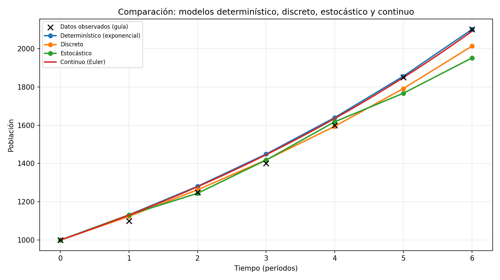
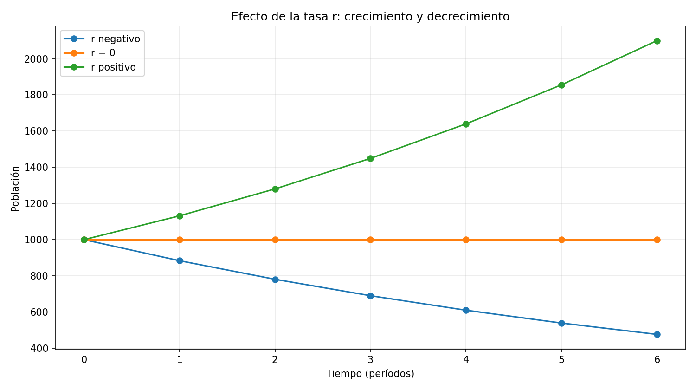

# APE 2: comparación de modelos determinísticos, estocásticos, discretos y continuos

Proyecto de **Simulación (Unidad 1, Semana 2)** que desarrolla los cuatro modelos de crecimiento poblacional definidos en la guía APE 002. Los algoritmos usan un mismo conjunto de siete valores observados, generan una comparación gráfica y muestran el efecto de los parámetros `r` (tasa de crecimiento), `σ` (desviación estándar del ruido) y `dt` (paso numérico). Toda la simulación, exportación y visualización se realiza exclusivamente con Python.

## Tecnologías

- **Python 3.10+**: cálculos, algoritmos e integración.
- **NumPy**: operaciones numéricas y generador de ruido normal reproducible.
- **Matplotlib**: gráficas de los modelos y los experimentos.
- **pytest**: pruebas automatizadas.

## Instalación y ejecución

Ubicarse dentro de `Unidad 1/Semana 2` y crear el entorno virtual:

```powershell
python -m venv .venv
```

En **Windows PowerShell**:

```powershell
.\.venv\Scripts\Activate.ps1
```

En **Linux o macOS**:

```bash
source .venv/bin/activate
```

Instalar las dependencias obligatorias y ejecutar:

```bash
python -m pip install -r requirements.txt
python main.py
```

También se puede variar el paso de Euler o la semilla:

```bash
python main.py --dt 0.05 --semilla 123
```

**Pruebas:**

```bash
python -m pytest -q
```

## Resultados

El programa guarda en `resultados/`:

- `comparacion_cuatro_modelos.png`: datos observados frente a los cuatro modelos.
- `influencia_tasa_r.png`: comparación de crecimiento (`r > 0`), estacionariedad (`r = 0`) y decrecimiento (`r < 0`).
- `influencia_ruido.png`: tres simulaciones estocásticas con `σ = 0`, `σ` estimada y `2σ`.
- `tabla_comparativa.csv`: población de cada modelo en los tiempos enteros, junto con la serie original.
- `metricas.csv`: error RMSE, MAPE y población final de cada simulación frente a los datos.





## Estructura

```text
Semana 2/
├── main.py                      # Ejecución de las cuatro estrategias
├── README.md                    # Descripción, resultados y preguntas
├── requirements.txt             # Dependencias Python
├── src/
│   ├── __init__.py
│   ├── datos.py                  # Serie observada de la guía
│   ├── modelos.py                # Strategy + Factory y los cuatro modelos
│   ├── experimentos.py          # Calibración, comparación y sensibilidad
│   └── reportes.py              # Vista: CSV y figuras
├── tests/
│   └── test_modelos.py          # Pruebas con pytest
└── resultados/                  # Tablas y figuras generadas
```

## Patrones de diseño

Se usa **Strategy** para mantener los cuatro algoritmos intercambiables mediante `ModeloPoblacional` y el método `simular()`. **Factory** (`FabricaModelos`) construye las cuatro estrategias. La organización del proyecto también sigue la separación **MVC**: `modelos.py` implementa la lógica de cálculo; `reportes.py` representa las salidas y `main.py`/`experimentos.py` coordinan la ejecución. Un modelo puede cambiarse sin alterar los gráficos ni el procedimiento principal.

## Escenarios y ecuaciones

Se usa exactamente el arreglo indicado en la guía:

```python
datos = [1000, 1100, 1250, 1400, 1600, 1850, 2100]
```

Los instantes de observación son `t = 0, 1, 2, 3, 4, 5, 6`. Los modelos son:

| Modelo | Regla implementada | Característica |
|:--|:--|:--|
| Determinístico | `P(t) = P₀ × exp(r × t)` | Sin azar; fórmula exponencial exacta. |
| Discreto | `Pₜ₊₁ = Pₜ + r × Pₜ` | Cambia por períodos enteros. |
| Estocástico | `Pₜ₊₁ = max(0, Pₜ + r × Pₜ + εₜ)`, `εₜ ~ Normal(0, σ)` | Incluye ruido normal y semilla fija. |
| Continuo con Euler | `Pₜ₊dt ≈ Pₜ + dt × r × Pₜ` | Aproximación numérica de `dP/dt = rP`. |

**Parámetros elegidos para hacer reproducible el ejercicio:** `P₀ = 1000`; `r = ln(2100/1000)/6 ≈ 0.12366`, calibrada usando los extremos del arreglo; `dt = 0.1`; `semilla = 42`. El programa calcula `σ` como desviación estándar muestral de los residuos de incremento `P(t+1) − P(t) − rP(t)`, con el arreglo suministrado. La guía da la estructura matemática, pero **no impone** esos procedimientos de calibración ni una semilla específica. Los modelos no deben coincidir exactamente con los siete datos: se comparan sus comportamientos.

**Diferencia de discretización:** el determinístico calcula la función exponencial en instantes enteros; el discreto realiza un salto de tamaño 1; el continuo utiliza pasos menores o iguales que `dt`. El estocástico suma ruido aditivo por cada período entero. Para comparar en CSV, se interpolan los resultados continuos a los instantes observados.

## Interpretación

Con `r > 0`, todos los modelos tienden a crecer; al usar `r < 0`, el determinístico decrece. Un mayor `σ` incrementa la dispersión y hace menos predecible la trayectoria estocástica. Un `dt` menor reduce el error de la aproximación Euler frente a la solución exponencial. El modelo discreto y el continuo difieren porque representan el tiempo de manera distinta.

## Autor

**[Pedro Jiménez](https://github.com/Pedro27-J)** — Carrera de Computación, Universidad Nacional de Loja.

## Preguntas de control y respuestas

**1. ¿Qué representa el arreglo de entrada?**  
Representa la población observada del sistema en siete instantes sucesivos: 1000, 1100, 1250, 1400, 1600, 1850 y 2100. Es la referencia para comparar las simulaciones.

**2. ¿Cuál es la diferencia entre un modelo determinístico y uno estocástico?**  
El determinístico siempre produce los mismos resultados para los mismos parámetros. El estocástico incorpora valores aleatorios y sus trayectorias pueden cambiar entre ejecuciones, salvo que se mantenga la semilla.

**3. ¿Qué efecto produce modificar la tasa (`r`)?**  
Aumentar `r` positiva acelera el crecimiento; hacerla cero mantiene la población constante en el determinístico; una `r` negativa produce decrecimiento exponencial.

**4. ¿Qué representa el parámetro (`σ`)?**  
Es la desviación estándar de la distribución normal del ruido en el modelo estocástico. Controla la magnitud típica de sus fluctuaciones aleatorias.

**5. ¿Qué ocurre cuando aumenta el nivel de ruido?**  
Crece la variabilidad entre trayectorias; pueden surgir incrementos o descensos más abruptos, por lo que una ejecución individual se vuelve menos predecible.

**6. ¿Cuál es la diferencia entre los modelos discreto y continuo?**  
El discreto calcula nuevos valores en períodos separados. El continuo representa cambios a cualquier instante; aquí se calcula mediante el método numérico de Euler usando pasos pequeños.

**7. ¿Qué función cumple (`dt`)?**  
Define el tamaño máximo de cada paso de Euler. Un valor menor suele mejorar la aproximación a la solución continua, aunque requiere más iteraciones.

**8. ¿Por qué es importante visualizar los resultados mediante gráficas?**  
Porque permite reconocer tendencias, comparar modelos, identificar diferencias de magnitud y observar cómo la tasa y la aleatoriedad modifican el comportamiento del sistema.

**9. ¿Qué modelo presenta comportamiento aleatorio?**  
El estocástico: introduce en cada período un valor generado a partir de una distribución normal con media cero y desviación estándar `σ`.

**10. ¿Cómo cambia la simulación cuando se introduce un nuevo arreglo de datos?**  
Se deben recalcular `P₀`, el número de períodos y los parámetros calibrados (`r` y `σ`). En consecuencia cambian las curvas y su comparación con las observaciones. Se puede sustituir la lista en `src/datos.py` para probar otros datos positivos.
